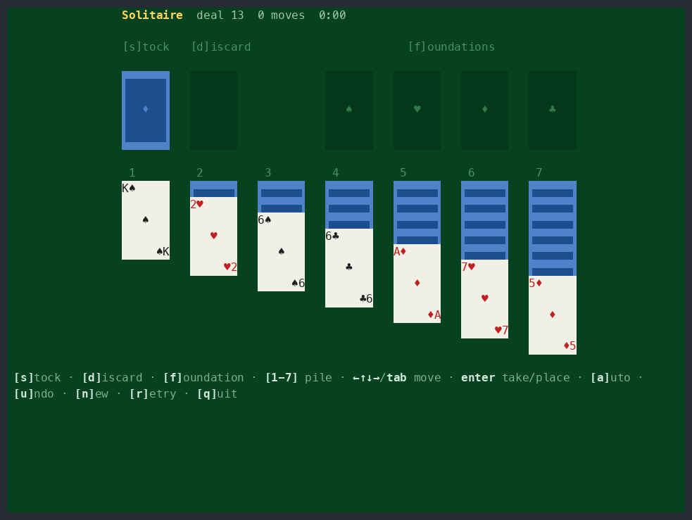
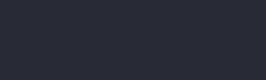

# TermDOM

**Build terminal apps with HTML, CSS, and DOM.**



TermDOM renders HTML and CSS in the terminal. It draws a real DOM and
redraws when it changes, so you can write terminal apps with plain
JavaScript or any frontend framework.

```sh
npm install @b9g/termdom
```

```ts
import {TermDOM} from "@b9g/termdom";

const term = new TermDOM();
term.attach();

const {document} = term;
document.body.innerHTML = `
  <style>
    .card { border: 1px solid #5fafff; padding: 0 1ch; width: 36ch; }
    .title { color: #5fafff; font-weight: bold; }
    progress { width: 25ch; }
    progress::slider-fill { background-color: green; }
    .pct { color: #888; }
  </style>
  <div class="card">
    <div class="title">Installing</div>
    <div>
      <progress id="bar" max="100" value="0"></progress>
      <span class="pct" id="pct"></span>
    </div>
  </div>
`;

let n = 0;
setInterval(() => {
  n = (n + 1) % 101;
  document.querySelector("progress")!.value = n;
  document.getElementById("pct")!.textContent = String(n).padStart(3) + "%";
}, 50);
```



## Features

- **Stylesheets**: the cascade and inheritance, drawn as ANSI colors
  and attributes.
- **Layout**: the box model, flexbox, grid, and tables, in whole cells.
- **Text**: correct widths for CJK, emoji, and combining characters;
  Hebrew and Arabic in visual order with shaping.
- **DOM**: `querySelector()`, `MutationObserver`, `ResizeObserver`, and
  `getBoundingClientRect()`, measured in cells.
- **Events**: keyboard, mouse, focus, and paste, decoded from stdin.
- **Forms**: inputs, textareas, selects, checkboxes, radios, and
  sliders, styleable with CSS.
- **Scrolling**: documents and `overflow` boxes, by wheel, keys, or
  `scrollTo()`.
- **Web Components**: custom elements, shadow DOM, `<slot>`, and
  scoped styles.
- **Selection**: drag to select, `::selection`, and readline keys in
  text fields.
- **Fullscreen**: `requestFullscreen()` uses the alternate screen and
  restores the shell on exit.
- **Images and canvas**: PNG, JPEG, GIF, and BMP, and 2D and cell-grid
  canvases, drawn two pixels per cell. A `csp` option and `"fetch"`
  listener control what loads.

## How it works

TermDOM runs the browser's rendering pipeline on a grid of character
cells. By default `1px` and `1ch` are both one cell. Each frame, it
recomputes style and layout for what changed, paints into a cell
buffer, and writes the difference from the last frame as ANSI escape
sequences. Input from stdin becomes DOM events.

## Examples

- [`markdown.ts`](./examples/markdown.ts) — a paging Markdown viewer.
- [`chat.ts`](./examples/chat.ts) — a streaming LLM chat client using
  [ch.at](https://ch.at).
- [`todomvc.ts`](./examples/todomvc.ts) — the official TodoMVC, with
  only the stylesheet changed.
- [`fuzzy-finder.ts`](./examples/fuzzy-finder.ts) — a file picker that
  prints the selection to stdout.
- [`weather.ts`](./examples/weather.ts) — a forecast from Open-Meteo,
  with city search.
- [`popover.ts`](./examples/popover.ts) — a menu bar built from
  `popover` attributes.
- [`codemirror.ts`](./examples/codemirror.ts) — CodeMirror editing a
  file, with line numbers and syntax highlighting.
- [`solitaire.ts`](./examples/solitaire.ts) — the solitaire above,
  played by keyboard or mouse.
- [`hello-{react,vue,svelte,crank}.ts`](./examples) — a key-press
  counter in each framework, using its standard renderer.
- [`ssh.ts`](./examples/ssh.ts) — an SSH server that gives each session
  its own document.
- [`shell.ts`](./examples/shell.ts) — `ls`, `cat`, `less`, `cd`, and
  `pwd`. On termdom.org, it browses this repository.
- [`images.ts`](./examples/images.ts) — an image under each
  `object-fit`. Pass a path or URL to show your own.
- [`canvas.ts`](./examples/canvas.ts) — an animated 2D canvas and
  Conway's Life on a cell-grid canvas.

More are in [`examples/`](./examples), and most also run in the
browser at [termdom.org/examples](https://termdom.org/examples/).

## Runtimes

Node, Bun, and Deno. There are no native dependencies, so
`bun build --compile` works.

## Compatibility

[COMPATIBILITY.md](./COMPATIBILITY.md) lists supported features,
generated by testing each one.

## Name

Not to be confused with [DomTerm](https://domterm.org) by Per Bothner,
which puts a terminal in the DOM. TermDOM puts the DOM in a terminal.

## License

MIT
